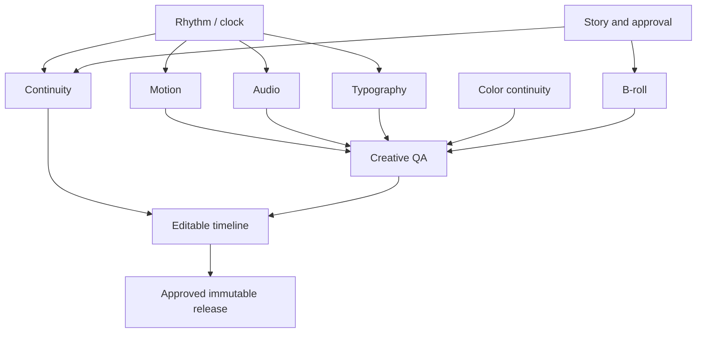

# SDD Implementation Plan — P15–P24

**State:** DRAFT / NO PRODUCTION EXECUTION. **Origin:** OpenSpec `professional-montage-p15-p24`.

## Architecture decision 001 — one canonical clock

Extend existing P09 timebase with rational FPS numerator/denominator + int64-ish ticks carried as string/validated safe integer where JSON clients risk precision loss. Cuts, J/L trims, word captions, speed ramps and exported timelines derive from this schedule; no independent per-agent float clocks. Establish parity fixtures 24, 25, 30, 24000/1001, 30000/1001 and 60 fps. Define timebase migration, stable cue IDs and cache invalidation.

## Architecture decision 002 — sidecars not editor-owned deck mutation

Store opt-in `montage/<component>-v1.json` under a project/scene authorized root, using explicit `schema_version`, ID, `expected_revision`, source SHA, field bounds and durable CAS. Existing `deck.json`, approved MP4 and author-owned voice remain untouched. Viewer=read, scene-worker=scoped writes, director=composition proposals, reviewer=approval, owner=rollout. All accesses go through actual server-side principal and P06 lease/fence check.

## Architecture decision 003 — reproducible mixed-media render

Input contract is explicit and typed: local licensed catalog URI, SHA-256, clip PTS, bounded filter graph, codec policy. Only approved artifact hashes enter assembly; no arbitrary shell interpolations, remote URLs, dynamic script or user-provided FFmpeg expressions. Production worker pools enforce memory, CPU, duration and concurrency budgets, with abort and retries preserving published pointer. Cache key includes *all* montage inputs, versions and renderer binary.

## Architecture decision 004 — visual and audio QA split

Hard technical FAIL: unreadable/corrupt media, mismatched PTS, missing mandatory voice, out-of-bounds text, expired rights, invalid SHA and ownership breach. REVIEW: subjective pacing, emotional effect, shot similarity, style preference and uncertain automated detector. Reviewer may override REVIEW with signed reason, never FAIL/permission/rights defects. QA evidence is immutable and timecoded; sampled frames are supplementary, not exhaustive.

## Architecture decision 005 — human authority, editable final source

A director proposes a beat structure but cannot change approved text; an editor can override timing and movement within explicit constraints. P24 is the canonical versioned editing graph and produces an OTIO/EDL supported-subset interchange with a loss manifest. The final MP4 is delivered together with source pins, typed EDL, review record, font/color/LUT license manifest and reproducibility instructions.

## Workstreams and dependency DAG

P15 and P19 can prototype independently using a shared timebase contract; production P19 integration waits for P15 C02. P16 may build read-only narratives early; user-facing dispatch only after P10 human approval and P17 contracts. Avoid global edits to other workstreams.

## Phases

**Phase A — contracts and evidence (all C01):** Review OpenSpec + SDD FR IDs, schema, permissions, threat model and compatibility. Implement test fixture builders using synthetic/owned clips and explicit source hashes. No production feature flags enabled.

**Phase B — vertical slices (all C02–C03):** Write minimal service implementation with typed APIs, read-only preview, bounded scheduler/FFmpeg adapters, opt-in UI/MCP. Every PR includes scenario tests, changed-file limits and prior-release protection.

**Phase C — adversarial QA (all C04):** Exercise invalid timebase, counterfeit reviews, licensing edge cases, forged metadata, path traversal, out-of-budget resources, concurrency, interruption and revision conflicts. Collect actual test exit codes and never claim missing evidence.

**Phase D — six-scene real E2E (all C05):** Own/authorized source video and voice; compare audible + visual transitions, known fonts, colors, per-scene render and P08 approval. Run real Chromium + FFmpeg Docker workflow, check PTS/loudness/glpyh bounds and reversible export. A/B against unmodified baseline.

**Phase E — canary and handover (all C06):** Deploy matching commit SHA to staging (not to production by default), run rollback and failure injection, compare Railway branch/image hash, measure CPU/memory/disk/timeout/5xx. Release only with human approval and recorded evidence.

## Roles and parallelism

- Developer 1: P15/P19; core clock and licensed audio mix.
- Developer 2: P17/P18; transitions and camera-motion sidecars.
- Developer 3: P20/P21; typography and color management.
- Developer 4: P22/P24; catalog rights and edit-graph interchange.
- Director + reviewer: P16/P23; explicit human approvals, no signing agent self-result.

Assignments above are planning hints; they do not grant permissions or auto-run jobs. Separate scene leases/branches, conflict detection, no anonymous push to main.

## Change control and code review

1. Read current `AGENTS.md`, OpenSpec capability, SDD story and exact assigned checkpoint.
2. Reserve one checkpoint and expected SHA; log activity/start timestamp, tests already executed, blockers.
3. Restrict PR to approved feature-owned files; link each requirement and negative test. Don't merge on skipped mandatory test.
4. Check OpenSpec strict, structural parity, cloud unit tests and Docker real media acceptance for relevant task.
5. Reviewer compares immutable evidence to live SHA, rejects stale approvals and signs; developer cannot self-accept.
6. Roll back only newly staged pointer/revision; never delete or mutate old approved outputs.
7. Update checkpoint registry via a separately reviewed commit with evidence, never by optimistic "done" status.

## Measurable release gates

- All 10 specs parsed with 30 requirements and 60 positive/negative scenarios.
- 60 checkpoints with `status=ACCEPTED`, populated evidence and no unresolved BLOCKED or REWORK.
- No unapproved external assets or license unknown; no unauthorized release.
- Six real H.264 scenes with one intentionally failed job, one cache hit, one source change, one audio overlap, one font fallback, and one expired worker token.
- Audio/video offset <=1 output frame on supported test modes; no mandatory voice loss.
- Viewer signs off on narrative, pacing and style based on blinded A/B; metrics presented as evidence rather than artistic truth.
- Historical published release still readable after crash/cancel/failed canary.

## Operational caveat

PressBuilder Railway may track a different branch than GitHub main. Any production evidence must record the actual Railway branch+commit, service health, and result of a real full-media test. Never infer deployment success from a GitHub PR merge or a green documentation lint run.
